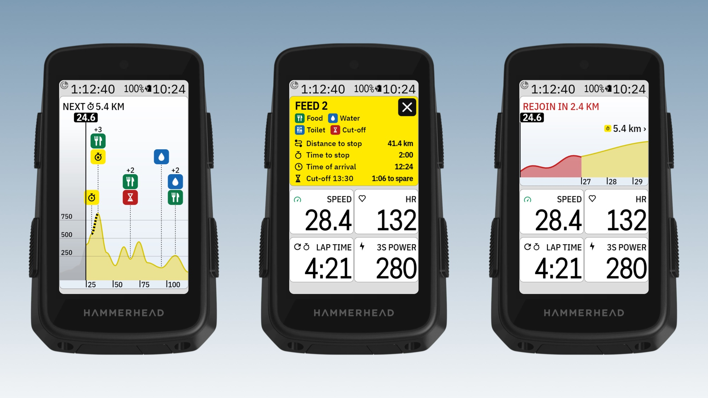
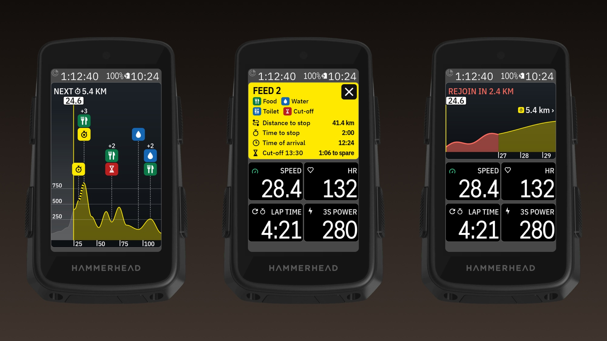

<!-- docs.sh: generated from docs/app.yml. Edit that file and run setup/docs.sh, not this block. -->

# UpAhead for Karoo 3

Listed on the Karoo as **DDB UpAhead**, next to the other DDB apps.

A Hammerhead Karoo 3 data field that shows the route ahead as an elevation graph, in the look of the Karoo's
own Upcoming Elevation, with every stop on it: feed stations with what they have (food, water, toilets,
mechanic), timing starts and ends, and the next cut-off. Made for gran fondos and long event rides.

- **Every stop on the graph:** the route's POIs as icons above the elevation graph, one column per stop, the most important ones first (your order).
- **Tap like the Karoo's own graph:** tap to zoom out, double-tap to zoom in, through 2, 5, 10, 25, 50, 80, 150 and 300 km and the whole route. A remote button works too.
- **Tap a stop** for its card: what's there, distance, time and time of arrival, and the cut-off with the time to spare.
- **At the top:** the next stop (or the next cut-off, feed, water, toilet, mechanic, summit or the finish), as distance or as time from your own speed.
- **Off route:** the Karoo's way back to the route in red, with its real heights, and how far until you rejoin.
- **Timed sections** striped on the graph; on the map, badges on the Karoo's own pins for timing and cut-offs.
- **Name your POIs** like "Feed 2: food water wc mechanic", "Timing start" or "Cut-off 16:40" (Hammerhead Dashboard or Ride with GPS).

Problems or ideas: [Issues](https://github.com/Dubadai/karoo-upahead/issues). The header and the long-press: the field's header line and the km strip take no taps, so a long-press there still changes the field as usual.

## Install on your Karoo

1. On your phone, open the [latest release](https://github.com/Dubadai/karoo-upahead/releases/latest)
   and share `upahead.apk` to the **Hammerhead Companion** app (or with a computer: `adb install upahead.apk`).
2. In a ride profile, add **DDB UpAhead → UpAhead** to a page, a half page or bigger works best.
3. Open **DDB UpAhead** from the app list for its settings.

It needs a route loaded on the Karoo. Stops come from the route's POIs (Hammerhead Dashboard pins or Ride with
GPS points of interest); off route, the way back's heights come from Open-Meteo over the Karoo's connection.

<!-- /docs.sh -->

## Licence

MIT, see [LICENSE](LICENSE). Uses [karoo-ext](https://github.com/hammerheadnav/karoo-ext) (Apache 2.0).
